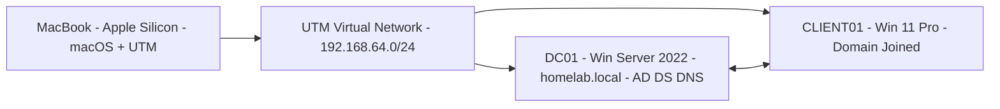
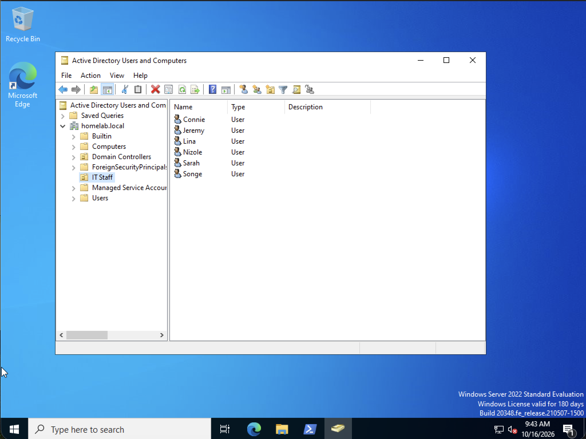

# Homelab AD Lab - Active Directory on Apple Silicon + UTM

> Built a complete Active Directory domain from scratch on a MacBook (Apple Silicon) using UTM. This project simulates a real small-business IT environment.

## Architecture
- **Host:** MacBook (Apple Silicon) - macOS + UTM Hypervisor
- **DC01:** Windows Server 2022 - Domain Controller - `homelab.local` - AD DS, DNS
- **CLIENT01:** Windows 11 Pro - Domain Joined Workstation
- **Network:** UTM Isolated NAT Network (192.168.64.0/24)

## What I Built
- [x] Installed Windows Server 2022 on ARM64 via UTM
- [x] Promoted server to Domain Controller: `homelab.local`
- [x] Configured DNS for internal domain resolution
- [x] Created OU structure: `IT Staff`
- [x] Created 5+ domain users with PowerShell (automated)
- [x] Bypassed Secure Boot Ctrl+Alt+Delete issue for ARM VMs via registry edit

## Technologies & Skills Demonstrated
`Active Directory DS` `DNS` `PowerShell` `Windows Server 2022` `Windows 11` `UTM` `Virtualization` `Apple Silicon` `User Management` `OU` `Troubleshooting`

Keywords for recruiters: AD DS, Domain Controller, Group Policy, DNS, PowerShell automation, Virtualization

## Setup Steps

### 1. Fix UTM Ctrl+Alt+Delete Trap (Apple Silicon)
In Windows Server, Run > regedit:
`HKEY_LOCAL_MACHINE\SOFTWARE\Microsoft\Windows\CurrentVersion\Policies\System`
Set `DisableCAD` = 1 (DWORD)
Also fix VMware driver: `HKEY_LOCAL_MACHINE\SYSTEM\CurrentControlSet\Services\vmmouse` -> Start = 4

### 2. Install AD DS
``powershell
Install-WindowsFeature AD-Domain-Services -IncludeManagementTools
Install-ADDSForest -DomainName "homelab.local" -SafeModeAdministratorPassword (ConvertTo-SecureString "Password123!" -AsPlainText -Force) -Force``

### Screenshots 

